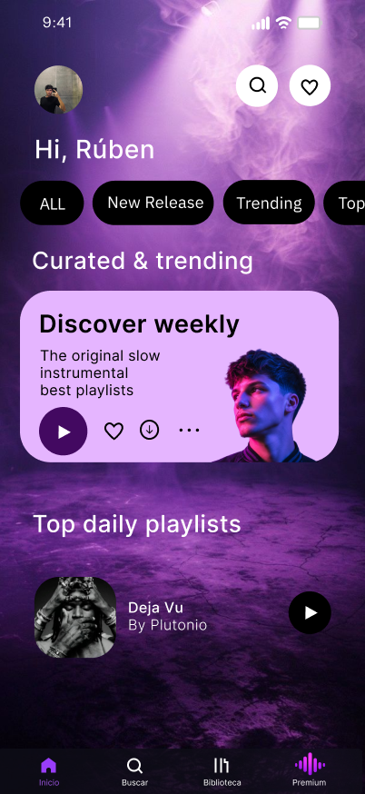
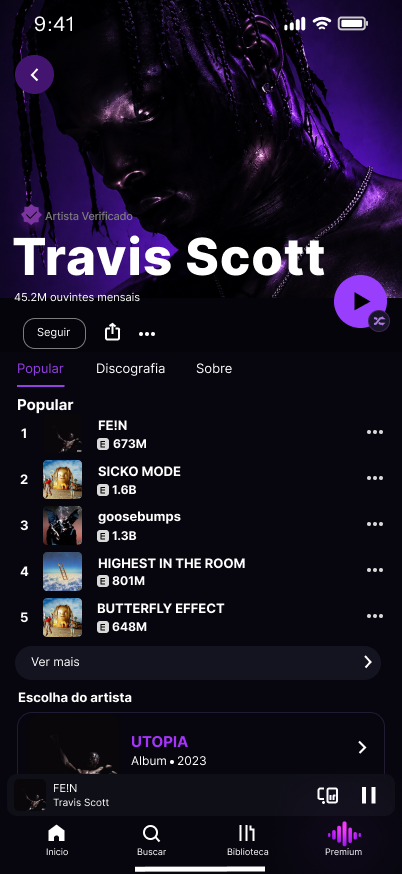
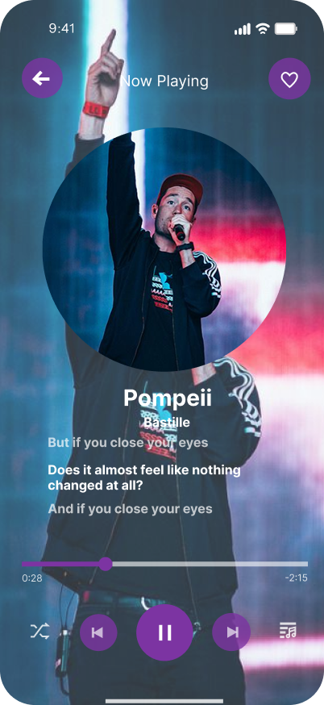
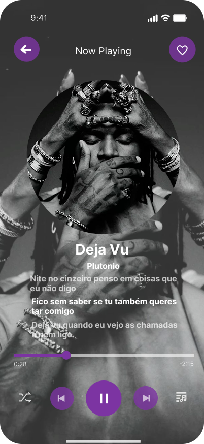
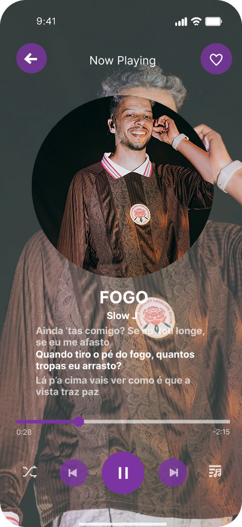
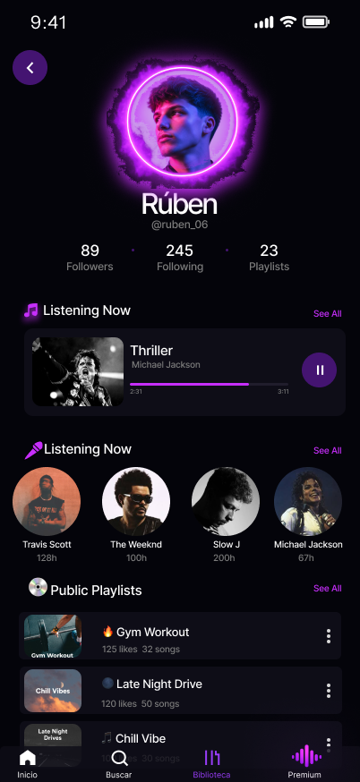
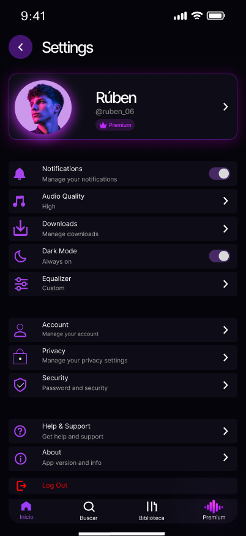
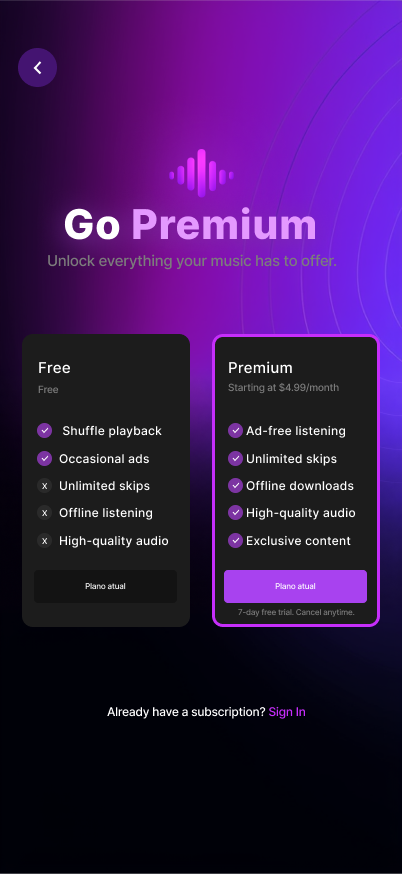

# App de Música – Layout

Design completo do layout de uma aplicação móvel de streaming de música, com descoberta de playlists, biblioteca pessoal, ecrã de reprodução com letras, perfis de artistas e plano Premium. Feito no Figma.

**Ficheiro Figma:** [Abrir](https://www.figma.com/design/q3Zldeh1HP8BHrVu4yLWtB/Projeto-Final-App?node-id=0-1&t=8tXzUuOTZBYjCWHt-1)

## O que fiz
- Desenhei todo o layout da aplicação, de raiz.
- Criei os ecrãs de descoberta de música e playlists.
- Criei o ecrã de reprodução com letras sincronizadas.
- Criei os ecrãs de perfil, definições e plano Premium.

## Ecrãs

### Explorar

### A tocar

### Perfil e definições

### Premium

